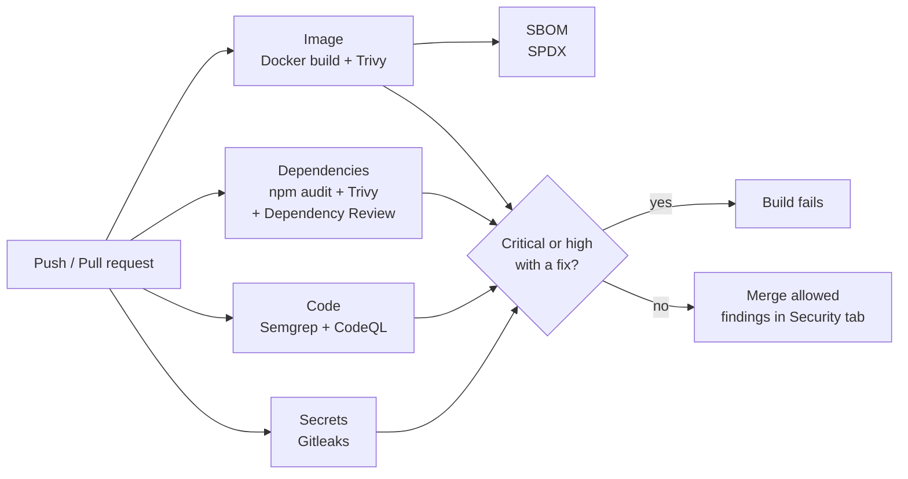

# secure-pipeline-demo

[](https://github.com/luan-evangelista/secure-pipeline-demo/actions/workflows/ci.yml)
[](https://github.com/luan-evangelista/secure-pipeline-demo/actions/workflows/security.yml)
[](https://securityscorecards.dev/viewer/?uri=github.com/luan-evangelista/secure-pipeline-demo)

A production-grade **security pipeline on GitHub Actions**, applied to a small TypeScript payments API.

Every push and pull request goes through five layers of checks. The build fails only on findings worth stopping a release for; everything else lands in the GitHub **Security** tab, so the team gets visibility without alert fatigue.

## What the pipeline checks



| Layer | Tool | Blocks the build when | Where results go |
| --- | --- | --- | --- |
| Secrets | Gitleaks (full git history) | any secret is found | Security tab (SARIF) |
| Code (SAST) | Semgrep (`p/default`, `p/typescript`, `p/javascript`) | an `ERROR`-severity rule matches | Security tab (SARIF) |
| Code (SAST) | CodeQL `security-extended` | never (report only) | Security tab |
| Dependencies (SCA) | `npm audit`, Trivy filesystem | a high/critical CVE has a fix | job log |
| New dependencies | Dependency Review (PRs) | a PR adds a high/critical CVE or a denied license | PR comment |
| Container | Trivy image scan | a high/critical CVE has a fix | Security tab (SARIF) |
| Supply chain | Syft SBOM (SPDX) | never | build artifact |
| Repo posture | OpenSSF Scorecard | never | Security tab + badge |

A weekly scheduled run re-scans `main`, because new CVEs show up in code that did not change.

## How the pipeline protects itself

The pipeline is also an attack surface, so it is hardened too:

- **Every action pinned to a full commit SHA**, with the version in a comment. A moved tag cannot change what runs. Dependabot keeps the SHAs current.
- **Least-privilege tokens**: `contents: read` by default; `security-events: write` only on jobs that upload results.
- **`persist-credentials: false`** on every checkout, so later steps cannot reuse the token.
- **Downloaded binaries verified** against a pinned SHA-256 before they run (Gitleaks).
- **Harden-Runner** in audit mode on every job, to record outbound network calls.
- **No secrets needed**: the whole pipeline runs on the default `GITHUB_TOKEN`.

## The application

A deliberately small payments API, written the way a PCI-aware team would write it:

- Accepts only **provider tokens** (`tok_…`), never raw card numbers, and never echoes the token back.
- Input validated with Zod: integer amounts, allow-listed currencies, bounded strings.
- `helmet` security headers, `x-powered-by` removed, 10 kB body limit, rate limiting.
- Generic error responses with no stack traces.
- Multi-stage Docker build on **distroless**, running as **non-root**, with a health check.

```bash
npm ci
npm test          # 6 tests, including security behaviour
npm run build && npm start
```

```bash
curl -X POST localhost:3000/payments \
  -H 'content-type: application/json' \
  -d '{"amount": 4990, "currency": "BRL", "cardToken": "tok_4f9a2c7e1b3d5f80"}'
```

## Handling findings

- **False positive on a test fixture?** Add an inline `gitleaks:allow` or `nosemgrep: <rule-id>` comment **with a reason**. See `test/app.test.ts`.
- **Real finding without a fix yet?** Track it as an exception with an owner and an expiry date instead of turning the check off.

## Use this in your project

1. Copy `.github/workflows/security.yml` and `.github/dependabot.yml`.
2. Change the CodeQL language and the Semgrep rulesets to your stack.
3. Enable **Code scanning** in *Settings → Code security* to see results in the Security tab.
4. Make the `Security` checks required in your branch protection rules.

For a reusable version you can call from any repository in ten lines, see [pipeline-security-kit](https://github.com/luan-evangelista/pipeline-security-kit).

## Need this in your pipeline?

I set up and tune security pipelines for teams on GitHub Actions: from a first scan to a gate your developers actually trust. **[levangelista.com.br](https://levangelista.com.br)**

## License

MIT
